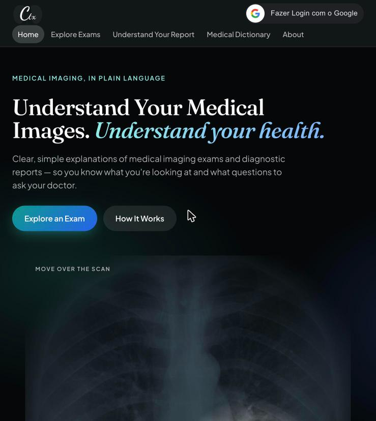
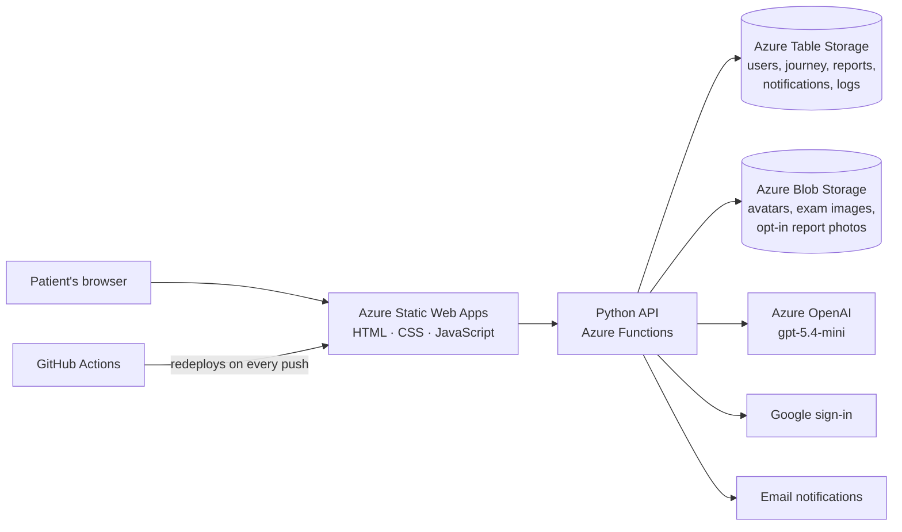

# Cortex

**Understand your medical report before you walk into your doctor's office.**

Cortex is a web app that translates medical imaging exams and diagnostic reports into plain, reassuring language. It explains what an exam is, what the words in a report mean, and helps the patient arrive at their appointment with the right questions already written down.

🔗 **Live app:** [Open Cortex](https://delightful-sand-03639cb1e.5.azurestaticapps.net/)

> The source code lives in a private repository for the course. This page is the project overview.

---

## Why I built it

I built Cortex after watching my grandmother struggle to understand her own exam reports. Medical language is confusing, and it can be scary to read alone. Someone who just got back an X-ray, MRI or CT report full of terms like *"pulmonary nodule"* or *"ground-glass opacity"* usually has to wait days to ask their doctor what it means. Cortex is for that wait. It doesn't replace the doctor. It helps the patient show up understanding the report and ready to talk about it.

---

## What it does

### 🧠 Explain my report (AI)
Paste a report or upload a photo of one, and Cortex explains it in plain English: first the whole report in one sentence, then each medical term, then questions worth asking the doctor.
- **The report works like a dictionary.** Every word can be tapped. Terms the AI or the glossary already explained open right away. Any other word is looked up by AI and saved to *Your words*.
- The original text and the explanation sit side by side, so the patient can fix a misread word and ask again.
- Every result is labelled *"Made by AI, check with your doctor"* and names the model.

### 🔍 Explore exams
Short guides to each exam type (what it's for, how to prepare, what to expect), each with an illustrative image.

### 🗺️ My Journey
A personal space to get ready for the visit:
- Exams the patient has viewed, each with notes and the doctors it was shown to
- Several doctors per patient (inspired by MyChart), each shown as a colored monogram avatar
- A saved checklist of questions for the doctor
- A one-page **visit sheet** to print, with the report, the plain-language meaning, the questions, and room for notes

### 📈 Exam timeline
One exam's full history on a single page, in date order: photos, report translations and notes. It answers the question patients actually ask: *"Is this better or worse than last time?"*

### 👨‍👩‍👧 Share with a family member
A read-only link to one exam that the patient controls: they pick what to include (terms, report text, notes, doctors), how long it lasts (1 to 30 days), and whether it opens once or many times. They can see and cancel their links, and they get a notification when one is opened.

### 🔔 Notifications
An in-app bell plus optional email, with deduplication, a retry queue for failed emails, per-member preferences and an unsubscribe page.

### 🔐 Accounts and roles
Google sign-in with two roles. **Admins** approve new sign-ups and manage other admins (never themselves, never the last admin). **Members** use the app and can only see and change their own data.

---

## Responsible AI

Cortex deals with health data, so the AI feature is designed around one rule: **it explains what the doctor already wrote and never makes a diagnosis.**

- **No scan interpretation.** Cortex never reads an X-ray, CT or MRI image for findings. If someone uploads a scan instead of a written report, it declines.
- **Always correctable.** The text it read is shown next to the explanation, and the patient can edit it and try again.
- **Prompt-injection aware.** Text inside an uploaded photo is treated as content, never as instructions. Model output is validated before it's stored and escaped before it's shown.
- **Privacy first.** A note next to the button says the report goes to Microsoft Azure AI and suggests covering your name. Photos are **not** stored unless the patient checks an opt-in box, and a deleted photo is really deleted.
- **Graceful failure.** If the model is down, slow or out of quota, the glossary result still shows.
- **Cost guardrails.** Each call runs only when the button is pressed, and it goes through a per-member limit and a daily app-wide ceiling. Results are saved, so the same report is never paid for twice.

Measured against Azure with made-up reports: about **$0.0016 and 2.3 s** to explain pasted text, and **$0.0026 and 3.7 s** for a photo. That's roughly $0.30 a month for 30 active members.

---

## Architecture

| Layer | Tech |
|---|---|
| Front end | HTML, CSS, JavaScript, served by Azure Static Web Apps |
| Back end | Python on Azure Functions |
| Data | Azure Table Storage (records) and Blob Storage (images) |
| AI | Azure OpenAI (`gpt-5.4-mini`) with a backup region |
| Auth | Google sign-in, with admin and member roles |
| Infrastructure | Bicep (infrastructure as code) |
| CI/CD | GitHub Actions: every push to `main` redeploys the live app |

### Data model highlights
Every table is keyed by the access pattern it serves. For example:

| Entity | Partition key | Row key | Why |
|---|---|---|---|
| Doctor-visit questions | `user_id` | `questionId` | A growing per-member list. Each question is one row. |
| Exam notes | `user_id` | `noteId` | A note written on a phone and one written on a laptop are both kept, and neither overwrites the other. |
| Exam shared with a doctor | `user_id` | `examId\|doctorId` | Adding or removing one doctor is a single-row write that can't undo another device's change. |
| Exam view history | `user_id` | `examId` | Viewing again updates the row instead of adding a new one. |

---

## Engineering practices

- **14 Architecture Decision Records (ADRs)** covering choices from last-write-wins on profile saves to how the AI feature handles health data.
- **Observability.** Every API route is traced (route, status, timing, member, and a request ID returned in `X-Request-Id`). Key events are logged to a table kept for 14 days and readable from an admin page. Secrets, request bodies and full email addresses are never logged.
- **Tested in production-like conditions.** Platform quirks that only showed up after deploying are documented in an ADR, and new routes are checked against the live site as well as the test suite.
- **Cross-browser.** Checked in Chromium, Firefox and Safari (WebKit), on an iPhone and a Pixel, in light and dark mode.
- **Design.** Teal-and-blue palette inspired by health plans, Fraunces serif headings with Plus Jakarta Sans for body text, cinematic black bands, and a 3D CT image stack.

---

## Roadmap

- **Questions for my report.** Doctor questions generated from the patient's own report instead of a fixed set.
- **Summarize before my visit.** A short summary of an exam's timeline, notes and explanations.
- **Search by what I mean.** Searching *"spot on my lung"* finds *"pulmonary nodule"* (semantic search).
- **Ask about my exam.** Answers based only on Cortex's own guides and dictionary, with sources shown (RAG). This comes last because it's the closest to medical advice and needs the most safety work.

---

## Credits

Example exam images in the demo data are openly licensed images from Wikimedia Commons:
- [Radiograph of Barton's fracture](https://commons.wikimedia.org/wiki/File:Radiograph_of_Barton%27s_fracture.jpg), Mikael Häggström, M.D. (CC0)
- [Normal posteroanterior (PA) chest radiograph](https://commons.wikimedia.org/wiki/File:Normal_posteroanterior_(PA)_chest_radiograph_(X-ray).jpg), Mikael Häggström, M.D. (CC0)
- [Solitary pulmonary nodule CT](https://commons.wikimedia.org/wiki/File:Solitary_pulmonary_nodule_CT_arrow.jpg), Lourens Willekes, Cherif Boutros and Michael A. Goldfarb, *J Cardiothorac Surg* 2008 (CC BY 2.0, resized)

---

## About

Built by **Geovana França** for the Advanced Computer Science Lab (INTC 4393) at Northwest University, Fall 2026.

[LinkedIn](https://www.linkedin.com/in/geovanaluiza) · [GitHub](https://github.com/geovanaluiza)

> ⚠️ Cortex is a student project for education. It is not medical advice, and it is not a substitute for talking with your doctor.
